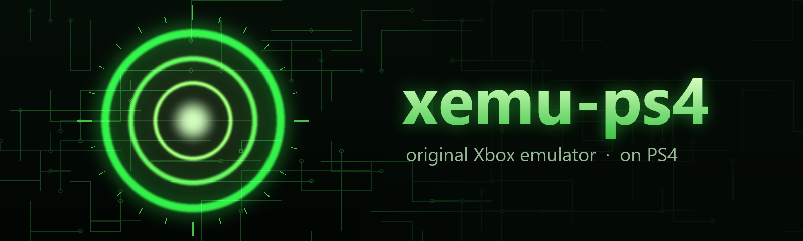

<p align="center">
  
</p>

<p align="center">
  <a href="https://github.com/iHaiDeeZ/xemu-ps4/releases/latest"></a>
  
  
  
  <a href="LICENSE"></a>
  <a href="https://discord.gg/fqjMs9gDJh"></a>
</p>

<h3 align="center">xemu, the original Xbox emulator, on a jailbroken PS4.</h3>

<p align="center">
  <a href="https://github.com/iHaiDeeZ/xemu-ps4/releases/latest"><b>⬇ Get the latest release</b></a> ·
  <a href="#getting-started">Getting started</a> ·
  <a href="#controls">Controls</a> ·
  <a href="#the-quick-menu">Quick menu</a> ·
  <a href="#faq">FAQ</a> ·
  <a href="#thanks">Credits</a>
</p>

---

## Overview

This is [xemu](https://xemu.app), the original Xbox emulator built on QEMU, ported to jailbroken PS4 consoles. The
Xbox's Pentium III code runs on QEMU's translator, its NV2A GPU is drawn by xemu's **Vulkan** renderer through Mesa's
RADV driver adapted to the PS4's AMD GPU, and its sound goes out through `sceAudioOut`. There's no OpenGL anywhere in
the PS4 build.

It installs as an app on the home screen, opens on a library of your games with their covers, and plays with a
DualShock 4. **L3 + R3** opens a quick menu.

On top of xemu, the port can run a game's code **translated ahead of time** on a PC, the way Crema does for Wii U
games: the console records the blocks of code a game runs, your PC compiles them, and the next start of the game runs
the compiled code instead of translating it again.

> **Status: experimental, and too slow for most games.** Development stopped at **v00.27** (2026-11-26). Crash
> Bandicoot: The Wrath of Cortex runs at 8-18 fps with its translated code; Halo 2 runs at 2-15 fps. See
> [Status](#status) for what was measured and why.

**You bring your own BIOS, hard disk image and games.** None are in this repository or its packages.

## Highlights

**Made for the PS4**
- xemu's Vulkan renderer presents straight to the PS4's VideoOut, with the menus drawn by Dear ImGui on the same
  Vulkan queue.
- The busy threads each get a core of their own (the emulated CPU, the GPU emulation, QEMU's main loop and the APU),
  and the rest share the others. The main loop sleeps with the PS4's most precise timer instead of spinning a core.
- Texture uploads go into the frame's own GPU commands, and image copies between surfaces run on the GPU (v00.27);
  each can be turned off for comparison.
- Sound: the APU's voices read guest memory directly and the 3D audio (HRTF) runs without divisions.

**Translated code (ahead of time)**
- The console writes each block of code a game runs as C (`/data/xemu/aot/<title ID>/`), from QEMU's own
  translation after its optimizer.
- `scripts/aot-console.sh` fetches the recording, compiles it on your PC with clang and puts the result back on
  the console; the next start of the game runs it. Blocks chain to each other with guaranteed tail calls, guest
  memory goes through flat page tables, and scalar SSE floats become host instructions.
- Hot game functions can be replaced by native C, each checked bit for bit against its translation
  (`aot/hooks/<title ID>.c`).
- How it all works: **[docs/TRANSLATED-CODE.md](docs/TRANSLATED-CODE.md)**.

**Looking inside**
- A live console on TCP port 4445 (`scripts/live.py`): frame rate and thread loads, QEMU's monitor, guest memory,
  CPU profiles, settings changed while the game runs.
- `scripts/hooker.py` profiles the running game by game block, shows the game's code at an address, explains why
  translated code goes back to the emulator, and times two builds of the translated code (or two values of a
  setting) live and keeps the faster.
- A frame rate and load overlay, a monitor log of the threads' loads and an automatic CPU profile when a game runs
  slowly, each with an off switch in the quick menu; a freeze report with every thread's stack, and ps4-kit's
  crash log.

## Status

| | |
|---|---|
| BIOS boot animation | 13-16 fps |
| Crash Bandicoot: The Wrath of Cortex | plays; 8-18 fps with translated code (v00.26) |
| Halo 2 | runs; 2-15 fps (v00.19, before translated code) |
| Other games | not tested |
| Tested on | a base PS4 on firmware 13.52 with GoldHEN |

Where the time goes, from profiles of Crash on the console:

- **In busy scenes the emulated CPU is the limit.** The Xbox has one CPU, so one PS4 core emulates it, and that
  thread is 92 % busy. Even translated ahead of time, each guest instruction costs several of the Jaguar's, and a
  fifth of the translated code's time is spent just entering blocks: the hot code is spread over more memory than the
  Jaguar's caches hold.
- **In other scenes it waits for the GPU.** Up to v00.26 the GPU emulation thread waited 72 % of the time: image
  copies read both surfaces back to the CPU, and every texture upload waited for the whole GPU queue. v00.27 removes
  those waits; it still doesn't make games full speed.

The development notes, version by version: [docs/PORTING.md](docs/PORTING.md) (up to v00.15) and
[docs/TRANSLATED-CODE.md](docs/TRANSLATED-CODE.md).

## Getting started

**You need:** a jailbroken PS4 with **GoldHEN** and an FTP connection to it; from your **own** Xbox, its **MCPX 1.0
boot ROM** (512 bytes) and **flash BIOS** (256 KiB or 1 MiB); a **hard disk image** in xemu's format (xemu's
[required files](https://xemu.app/docs/required-files/) page explains it); and your games as **XISO `.iso`** files.

1. Download **`xemu-ps4-v00.27.pkg`** from the [latest release](https://github.com/iHaiDeeZ/xemu-ps4/releases/latest),
   copy it to the console (FTP to `/data/pkg`) and install it with GoldHEN's **Package Installer**.
2. Start **xemu** once. It makes `/data/xemu` and its folders, then tells you the BIOS files are missing.
3. Copy your files over FTP:
   - the boot ROM and the flash BIOS to **`/data/xemu/bios/`** (any names: they're found by their size),
   - the hard disk image to **`/data/xemu/hdd/xbox_hdd.qcow2`**,
   - your games to **`/data/xemu/games/`**.
4. Start xemu again. The library shows your games; pick one with **Cross**.

> **Tip:** the library takes each game's cover from its own title image. To use your own, put
> `<the iso's name>.png` or `.jpg` in `/data/xemu/covers/`.

**Updating:** install the newer package on top. `/data/xemu` and everything in it stay.

### Translated code (optional)

It needs a PC with WSL 2 (Ubuntu, clang 21) and this repository.

1. With **Translated code** and **Record for PC** on (the default), start the game from the library and play the
   parts you want fast. Only code that runs is recorded.
2. On the PC, in Git Bash: `scripts/aot-console.sh all <title ID> <console IP>`. It fetches the recording, builds
   `out/aot/<title ID>.aot` (a few minutes) and uploads it as `/data/xemu/aot/<title ID>.aot`.
3. Start the game again from the library.

The title ID is the name of the folder the recording goes to in `/data/xemu/aot/`. A translated file fits only the xemu version that recorded it:
after an update, record and build again. The recordings and the builds are your game's code: keep them to yourself
(git leaves out `aot-data/` and `out/aot/`).

### Building the package

The build runs in WSL and needs **[ps4-kit](https://github.com/iHaiDeeZ/ps4-kit)** set up first: `~/ps4-kit`, its
sysroot in `~/ps4kit-build/sysroot` and its RADV build in `~/ps4kit-build/build/mesa`.

```bash
scripts/seed-build-tree.sh                    # ~/xemups4-build, and the link ~/xemups4 to this repository
scripts/clone-xemu.sh                         # xemu at patches/BASE.txt with the PS4 patch, on branch ps4
scripts/build-deps.sh all                     # glib, pixman, libsamplerate, SDL3 with the PS4 audio driver, Vulkan headers
scripts/rebuild-xemu.sh                       # configure and build (logs in ~/xemups4-build/logs)
XEMU_VERSION=00.27 scripts/package-xemu.sh    # out/xemu-ps4-v00.27.pkg
scripts/save-patch.sh "message"               # commit ~/xemups4-build/src/xemu and refresh patches/xemu-ps4.patch
```

Run them through `~/xemups4` (the space in "PS4 Projects" breaks linker flags). Upload from Windows (Git Bash) with
`scripts/upload-to-console.sh out/xemu-ps4-vXX.YY.pkg [IP]`.

## Controls

| DualShock 4 | Xbox controller |
|---|---|
| Cross / Circle / Square / Triangle | A / B / X / Y |
| L1 / R1 | White / Black |
| L2 / R2 | Left / right trigger |
| OPTIONS | Start |
| Touch pad click | Back |
| Left / right stick | Left / right stick |
| L3 / R3 | Stick clicks |
| D-pad | D-pad |
| **L3 + R3** | Open or close the quick menu |

The pad is the controller in port 1, with rumble.

**In the game library:** Left / Right choose a game, **L1 / R1** jump five, **Cross** plays, **Triangle** reads the
folder again, **OPTIONS** opens the settings (the quick menu) and **Circle** goes back to the game you left.

## The quick menu

**L3 + R3** while playing (again, or **Circle**, to close it). Up / Down move (the left stick too), **Left / Right**
change a setting, **Cross** picks. Settings are saved at once.

| Row | Choices |
|---|---|
| Resume | back to the game |
| Games... | the library, with the game paused |
| Eject disc | ejects the game's disc |
| Reset Xbox | restarts the Xbox |
| Picture | **Fit**, Stretch, Integer |
| Filter | **Smooth**, Sharp |
| Show frame rate | **On**, Off |
| Show load | **On**, Off: the GPU and thread loads under the frame rate |
| CPU layout | **Pinned** (each busy thread on its own core), Floating (restart) |
| Voice resampling | **Linear**, Sinc (xemu's own: far slower) (restart) |
| 3D audio (HRTF) | **On**, Off |
| Monitor log | **On**: a line of thread loads in `boot-trace.log` every 5 s |
| TLB dirty index | **On**, Off (restart) |
| Auto profile | **On**: an 8 s CPU profile when the game runs slowly |
| Translated code | **On**: runs `/data/xemu/aot/<title ID>.aot` if there is one (next game) |
| Record for PC | **On**: records the code the game runs, for the PC's build (next game) |
| Profile 8 s now | a CPU profile to `/data/xemu/profiles/` |
| Quit xemu | back to the home screen |

The defaults are in bold. `ps4.ini` has a few more, which the live console can also change while a game runs
(`python scripts/live.py --host <IP> set <key> <value>`):

| Key | Default | What |
|---|---|---|
| `gpu_blit` | 1 | image copies between surfaces on the GPU |
| `async_tex` | 1 | texture uploads without a wait for the GPU each |
| `gpu_module` | 0 | the GPU emulation thread on the other half of the CPU (its own L2 cache) |
| `aot_direct` | 1 | translated blocks run the next one without going back to the emulator |
| `boot_launcher` | 1 | start in the game library |
| `live_port` / `gdb_port` | 4445 / 0 | the live console's port; QEMU's GDB stub for the guest CPU (0 = off) |
| `voice_workers`, `audio_frames` | 2, 512 | the APU's voice threads, the sound buffer in frames (restart) |
| `profiler` | 0 | a 1 kHz sampler of every thread (restart) |

## Your files

Everything sits in **`/data/xemu/`**:

- `bios/`: the boot ROM and the flash BIOS
- `hdd/xbox_hdd.qcow2`: the hard disk, with your saves
- `games/`: your games (`.iso`)
- `covers/`: your own covers, and the library's cache of them
- `aot/`: translated code: `<title ID>/blocks-NNNN.c` recordings and `<title ID>.aot` builds
- `ps4.ini`: the PS4 settings (the quick menu writes it); `xemu.toml`, `eeprom.bin`: xemu's own
- `xemu.log`, `boot-trace.log`, `crash.log`, `hang.log`: xemu's log, ps4-kit's start-up trace, its crash record and
  the freeze report
- `profiles/`: the CPU profiles

## FAQ

**Why is it so slow?**
The Xbox's one CPU is emulated on one of the PS4's 1.6 GHz Jaguar cores, and every guest instruction costs several of
the Jaguar's, translated ahead of time or not. Fast memory tricks that other emulators use don't fit either: the PS4
maps memory in 16 KiB pages and the Xbox in 4 KiB ones. See [Status](#status).

**Can I download translated code for a game?**
No. It's the game's own code, compiled: record and build your own (see
[Translated code](#translated-code-optional)).

**Where do I get the BIOS and the hard disk image?**
From your own Xbox. xemu's [required files](https://xemu.app/docs/required-files/) page explains what they are. This
project won't help you find them.

**Which games work?**
Only Crash Bandicoot: The Wrath of Cortex and Halo 2 were tried, both slow. Others may not start at all.

**How do I report a bug?**
In an [issue](https://github.com/iHaiDeeZ/xemu-ps4/issues) or on [Discord](https://discord.gg/fqjMs9gDJh), with
`xemu.log`, `boot-trace.log` and, if there are any, `crash.log` and `hang.log` from `/data/xemu/`. Development has
stopped, so fixes may not come.

## Good to know

- v00.27 is the last version: development stopped on 2026-11-26.
- Save in the game: saves live on the hard disk image and carry over to new versions.
- The quick menu pauses nothing: the game keeps running behind it (Games... pauses it).
- Translated code that no longer matches the game (after an update of xemu) is ignored, not run wrong.

## Community

Join the **[Discord](https://discord.gg/fqjMs9gDJh)** for help and news.

## Thanks

- **[xemu](https://github.com/xemu-project/xemu)** by Matt Borgerson and its contributors, and
  **[QEMU](https://www.qemu.org)**: the emulator itself
- **[Mesa](https://mesa3d.org)**: the RADV Vulkan driver that draws every frame
- **[ps4-kit](https://github.com/iHaiDeeZ/ps4-kit)**: the PS4 runtime, toolchain, VideoOut swapchain and packaging
- **[SDL](https://libsdl.org)**, **[GLib](https://gitlab.gnome.org/GNOME/glib)**, **[pixman](https://pixman.org)**,
  **[libsamplerate](https://github.com/libsndfile/libsamplerate)** and **[Dear ImGui](https://github.com/ocornut/imgui)**
- **Roboto** by Google: the library's font
- Crema: the idea of translating ahead of time on the PC
- **[OpenOrbis](https://github.com/OpenOrbis)** and **[PacBrew](https://github.com/PacBrew)**: the PS4 toolchains
- **GoldHEN**: the homebrew enabler the package runs under

## License and disclaimer

**GPL-2.0-or-later**, as xemu and QEMU ([LICENSE](LICENSE)): `patches/xemu-ps4.patch` is a modification of xemu, and
the PS4 frontend it adds (`ui/ps4`) is part of that work. The PS4 runtime in `port/` and the toolchain scripts come
from ps4-kit and the ports before it; `port/mesa/ac_ps4_drm.c` is the RADV winsys of the PS4 Mesa port (MIT, as
Mesa); `port/third_party` keeps its own notices.

This is a fan-made project with no ties to Microsoft, Sony Interactive Entertainment, the xemu project or the
authors of the projects it builds on. Xbox is a trademark of Microsoft; PlayStation and PS4 are trademarks of Sony
Interactive Entertainment. No BIOS, boot ROM, system files or games are included. Please only play games you own.
This project won't help you find BIOS or game files.
